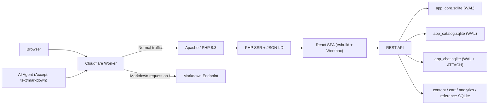

# Friday Shop (Architecture & Code Samples)

[อ่านภาษาไทย (README.th.md)](README.th.md)

Live site: [shop.friday-pet.com](https://shop.friday-pet.com)

Friday Shop is a small-pet supply storefront and affiliate catalog I built and run in production in Thailand. Because the live store is commercial, the full codebase stays private. This repo holds a few sanitized parts of the backend, edge worker, and build setup so you can see how I structure code without me putting the whole business online. Happy to walk through the full repo during an interview.

## How requests flow

The storefront renders initial HTML, meta tags, and JSON-LD in PHP so search crawlers get real markup on first byte, then hands off to a React SPA on the client.

## Notes on a few parts I pulled out

**Splitting SQLite by domain** ([`samples/multi-sqlite-setup.php`](samples/multi-sqlite-setup.php))  
Putting analytics, chat, catalog, and checkout writes into one SQLite file causes lock contention once traffic picks up. Splitting them into separate WAL-mode databases (`core`, `catalog`, `chat`, `content`, `cart`, `analytics`, `reference`) lets heavy write paths stay out of each other's way. When a query actually needs tables from another domain, the connection uses `ATTACH DATABASE` instead of duplicating data.

**Rate limiting without locking the database** ([`samples/rate-limit.php`](samples/rate-limit.php))  
Login brute-force protection belongs in SQLite so lockouts survive PHP worker restarts, with exponential backoff keyed by SHA-256 hashes of the normalized email and bucketed client IP. High-frequency endpoints like click tracking and chat polling don't use the database at all; they check APCu first and fall back to `flock()` on per-bucket JSON files.

**Markdown negotiation at the edge** ([`samples/cloudflare-worker.js`](samples/cloudflare-worker.js))  
AI crawlers and agent-readiness scanners often send mixed `Accept` headers containing both `text/html` and `text/markdown`, so strict `q`-value parsing misses them. The Cloudflare Worker checks for `text/markdown` as a substring on `/` and fetches the Markdown response from origin with `Vary: Accept`.

**In-browser WebMCP tools** ([`samples/webmcp-tools-excerpt.js`](samples/webmcp-tools-excerpt.js))  
Browser agents calling `modelContext` tools shouldn't dump POST payloads into query strings (where they end up in access logs), and throwing raw JS errors turns into opaque `DOMException` failures. The wrapper keeps POST data in the request body, returns structured error objects, and marks third-party marketplace copy with `untrustedContentHint: true`.

**Incremental frontend bundling** ([`samples/build-pipeline-excerpt.js`](samples/build-pipeline-excerpt.js))  
Instead of checking file `mtime` (which breaks after a fresh clone or zip extract), the build script hashes the actual contents of the critical storefront, deferred page, and admin JS/PHP groups with MD5 and skips bundles whose inputs haven't changed.

## Stack

PHP 8.3, SQLite (PDO + WAL), React, TanStack Query, Tailwind CSS, esbuild, Workbox, Cloudflare Workers, Apache.
