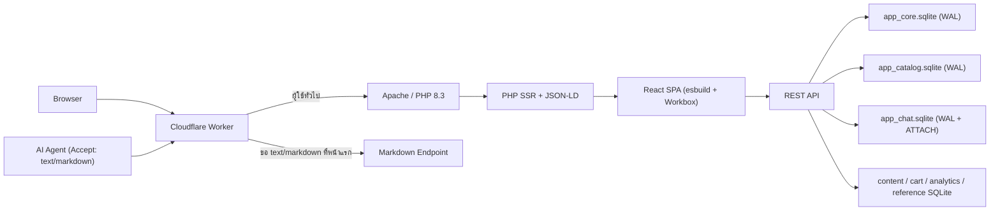

# Friday Shop (สถาปัตยกรรมระบบและตัวอย่างโค้ด)

[Read in English (README.md)](README.md)

เว็บจริง: [shop.friday-pet.com](https://shop.friday-pet.com)

Friday Shop เป็นร้านค้าออนไลน์และระบบรวมสินค้า Affiliate สำหรับสัตว์เลี้ยงขนาดเล็กที่ผมพัฒนาและดูแลบนเซิร์ฟเวอร์จริง เนื่องจากเป็นเว็บที่ขายของเชิงพาณิชย์ โค้ดชุดเต็มจึงเก็บเป็น Private ไว้ รีโปนี้คัดเฉพาะบางส่วนของ Backend, Cloudflare Worker และ Build Script ที่ตัดข้อมูลเฉพาะของร้านออกแล้ว มาวางไว้ให้ดูแนวทางการออกแบบและเขียนโค้ดครับ หากถึงรอบสัมภาษณ์เทคนิคสามารถเปิดโค้ดชุดเต็มอธิบายให้ดูได้

## ภาพรวมการทำงาน

หน้าแรกและหน้าสำคัญจะเรนเดอร์ HTML, meta tag และ JSON-LD จาก PHP ก่อน เพื่อให้ bot ของ Search Engine อ่านข้อมูลได้ทันที แล้วค่อยให้ React SPA รับช่วงทำงานต่อฝั่ง client

## จุดที่คัดมาให้ดูในรีโปนี้

**การแยก SQLite ตามหน้าที่เพื่อลดปัญหา Lock** ([`samples/multi-sqlite-setup.php`](samples/multi-sqlite-setup.php))  
ถ้าเอาข้อมูลเก็บสถิติ แชท สินค้า และออเดอร์ยัดรวมไว้ในไฟล์ SQLite เดียว เวลาคนเข้าใช้งานพร้อมกันจะเกิดอาการคิวรอเขียนชนกัน ผมเลยแยกไฟล์ตามลักษณะการเขียนเป็น `core`, `catalog`, `chat`, `content`, `cart`, `analytics` และ `reference` เปิดโหมด WAL ทุกไฟล์ ส่วนจังหวะไหนที่ต้อง join ข้ามโดเมนค่อยใช้ `ATTACH DATABASE` เชื่อมเฉพาะเท่าที่จำเป็น

**ระบบ Rate Limit ที่ไม่ไปขวางการทำงานของฐานข้อมูลหลัก** ([`samples/rate-limit.php`](samples/rate-limit.php))  
ตัวกันเดารหัสผ่านตอนล็อกอินเก็บลง SQLite เพื่อให้ยังนับต่อได้แม้ PHP worker รีสตาร์ท โดยแฮชอีเมลและ IP เป็น SHA-256 และเพิ่มเวลารอแบบทวีคูณเมื่อผิดติดๆ กัน ส่วน endpoint ที่ยิงถี่ๆ อย่างเก็บสถิติการคลิกหรือแชท จะไม่แตะ SQLite เลย แต่ไปเช็คใน APCu ก่อน ถ้าไม่มีค่อยใช้ไฟล์ล็อกผ่าน `flock()` แทน

**การส่งหน้า Markdown ให้ AI Agent จากชั้น Cloudflare** ([`samples/cloudflare-worker.js`](samples/cloudflare-worker.js))  
ตัวสแกนเว็บและ AI Agent หลายตัวส่ง header `Accept` ที่มีทั้ง `text/html` และ `text/markdown` ปนกันมา ถ้าเช็คค่า `q-value` แบบตรงตัวมักจะหลุด Worker ตัวนี้เลยดักดู substring `text/markdown` ที่หน้า `/` แล้วดึงฉบับ Markdown จาก origin ส่งกลับไปพร้อม `Vary: Accept`

**เครื่องมือ WebMCP บนเบราว์เซอร์** ([`samples/webmcp-tools-excerpt.js`](samples/webmcp-tools-excerpt.js))  
เวลา Agent ในเบราว์เซอร์เรียกใช้งาน tool ผ่าน `modelContext` ตัว wrapper จะบังคับส่งข้อมูลแบบ POST ไว้ใน body เพื่อไม่ให้พารามิเตอร์อย่างตะกร้าหรือที่อยู่หลุดไปอยู่ใน URL/Access Log, คืน error เป็น object โครงสร้างชัดเจนแทนการ throw แล้วพังเป็น `DOMException` และติด `untrustedContentHint: true` ไว้กับข้อมูลสินค้าจากร้านภายนอก

**Build Pipeline ที่เช็คการเปลี่ยนแปลงจากเนื้อหาไฟล์** ([`samples/build-pipeline-excerpt.js`](samples/build-pipeline-excerpt.js))  
แทนที่จะดูเวลาแก้ไขไฟล์ (`mtime`) ซึ่งมักเพี้ยนเวลา clone หรือแตก zip ใหม่ สคริปต์ build จะคำนวณ MD5 จากเนื้อหาจริงของกลุ่มไฟล์ storefront, หน้าโหลดทีหลัง (deferred) และหน้าแอดมิน เพื่อข้ามการ build ซ้ำในส่วนที่ไม่ได้แก้

## เครื่องมือที่ใช้

PHP 8.3, SQLite (PDO + WAL), React, TanStack Query, Tailwind CSS, esbuild, Workbox, Cloudflare Workers, Apache
